<!--
  Stats/pin/top-langs cards use a SELF-HOSTED github-readme-stats instance
  (github-readme-stats-delta-ashy-43.vercel.app) to avoid the public instance's 503 rate-limits.
  If that Vercel deployment is ever removed, redeploy a fork of anuraghazra/github-readme-stats
  (env var PAT_1 = a GitHub token) and replace the host in the card URLs below.

  Design notes: ASCII / old-print theme. Monochrome bone-on-ink
  (dark: #ECE6D6 / #B3AC99 / #7A7465, light: #1E1B16 / #4D483E / #8A8475), theme-aware via
  <picture> tags. The hero + divider SVGs in assets/ are generated by scripts/build_ascii.py —
  edit the art there and re-run `python scripts/build_ascii.py`.
-->

<div align="center">

<picture>
  <source media="(prefers-color-scheme: dark)" srcset="assets/hero-dark.svg">
  
</picture>

<br><br>

<picture>
  <source media="(prefers-color-scheme: dark)" srcset="assets/divider-dark.svg">
  
</picture>

<p>
  <a href="https://kylev202.github.io/2026Portfolio/"><code>portfolio</code></a>&nbsp;&nbsp;✦&nbsp;&nbsp;
  <a href="https://www.linkedin.com/in/duykhiemvu/"><code>linkedin</code></a>&nbsp;&nbsp;✦&nbsp;&nbsp;
  <a href="mailto:kylevu858@gmail.com"><code>email</code></a>&nbsp;&nbsp;✦&nbsp;&nbsp;
  <a href="https://github.com/kylev202?tab=repositories"><code>repositories</code></a>
</p>


</div>

```text
 > whoami
   kyle vu .. full-stack engineer
   i build practical, well-crafted software -- tools that make
   learning and everyday work easier. i care about local-first
   architecture, thoughtful ux, and getting the details right.

 > cat now.log
   [*] growing arbora
   [*] exploring on-device rag + local-first sync
   [ ] happy to talk tauri, fsrs, or study tooling
```

### `~/featured`

**[Arbora](https://github.com/kylev202/Arbora)** — a study assistant that never phones home.
Turns documents and lectures into grounded, cited notes, flashcards, and quizzes, then schedules
review with FSRS spaced repetition. Everything runs — and stays — on your device.

<a href="https://github.com/kylev202/Arbora">
  <picture>
    <source media="(prefers-color-scheme: dark)" srcset="https://github-readme-stats-delta-ashy-43.vercel.app/api/pin/?username=kylev202&repo=Arbora&hide_border=true&bg_color=00000000&title_color=ECE6D6&icon_color=B3AC99&text_color=7A7465">
    
  </picture>
</a>

**[2026Portfolio](https://github.com/kylev202/2026Portfolio)** — selected work, in one place.
Projects, background, and ways to get in touch, served as a static site on GitHub Pages.
**[Visit the live site →](https://kylev202.github.io/2026Portfolio/)**

### `~/inventory`

```text
+-------------+-----------------------------------------------+
|  languages  |  typescript   javascript   rust   python      |
|  frontend   |  react   vite   tauri                         |
|  backend    |  fastapi   sqlite                             |
|  tooling    |  git   github-actions   vs-code               |
+-------------+-----------------------------------------------+
```

### `~/activity`

<p>
  <picture>
    <source media="(prefers-color-scheme: dark)" srcset="https://github-readme-stats-delta-ashy-43.vercel.app/api?username=kylev202&show_icons=true&hide_border=true&include_all_commits=true&count_private=true&hide=contribs&bg_color=00000000&title_color=ECE6D6&icon_color=B3AC99&text_color=7A7465&ring_color=B3AC99">
    
  </picture>
  <picture>
    <source media="(prefers-color-scheme: dark)" srcset="https://github-readme-stats-delta-ashy-43.vercel.app/api/top-langs/?username=kylev202&layout=compact&hide_border=true&langs_count=6&bg_color=00000000&title_color=ECE6D6&text_color=7A7465">
    
  </picture>
</p>

<!-- Contribution snake — regenerated daily to the `output` branch by .github/workflows/snake.yml -->
<picture>
  <source media="(prefers-color-scheme: dark)" srcset="https://raw.githubusercontent.com/kylev202/kylev202/output/github-contribution-grid-snake-dark.svg">
  
</picture>

<div align="center">

<picture>
  <source media="(prefers-color-scheme: dark)" srcset="assets/divider-dark.svg">
  
</picture>

<sub><code>( build things that help. )</code></sub>

</div>
