<!--
  Every image on this page is a generated SVG sharing one theme (scripts/theme.py):
  monochrome terminal windows, monospace type, the same borders, radii and palette.

  - assets/*.svg — static cards. All copy lives in the PROFILE section of
    scripts/build_assets.py; edit it there and run `python scripts/build_assets.py`.
  - stats.svg + activity-graph.svg — live data, rendered daily by scripts/profile_stats.py
    via .github/workflows/profile-assets.yml and published to the `output` branch.
-->

  <a href="https://kylev202.github.io/2026Portfolio/">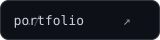</a>
  <a href="https://www.linkedin.com/in/duykhiemvu/">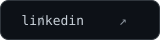</a>
  
  <a href="https://github.com/kylev202/Arbora">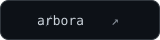</a>
  

 

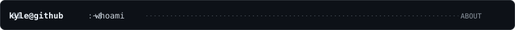

  

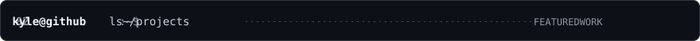
<a href="https://github.com/kylev202/Arbora">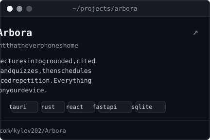</a>
<a href="https://github.com/kylev202/2026Portfolio">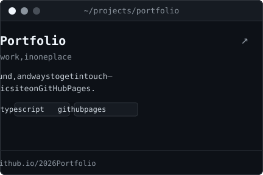</a>

  

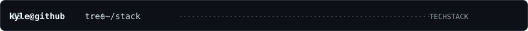
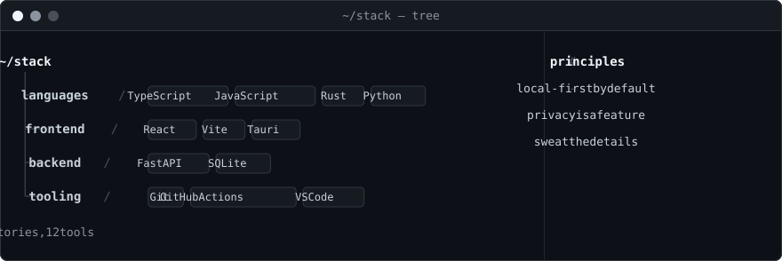

  

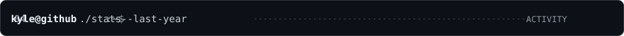

  


