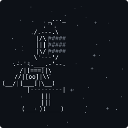

<!--
  Design: black & white, ASCII-art accents. Same look in GitHub's light and dark themes
  (every image carries its own dark background).

  - assets/terminal.svg (neofetch-style intro), assets/astronaut.svg — generated by
    scripts/build_ascii.py; edit INFO / the art there, then run `python scripts/build_ascii.py`.
  - Contribution graph — rendered daily by scripts/activity_graph.py via
    .github/workflows/profile-assets.yml and published to the `output` branch.
  - GitHub stats / pin cards use the public github-readme-stats instance. The self-hosted one
    (github-readme-stats-delta-ashy-43.vercel.app) errored as of 2026-10 ("Resource not accessible
    by personal access token") — refresh its PAT_1 env var on Vercel, then swap the host back
    if the public instance starts rate-limiting.
  - Badges: shields.io, black for-the-badge. LinkedIn and VS Code use inline SVG logos
    because simple-icons no longer ships those brands.
-->

  

<h2 align="center">🪐 About me</h2>

Hello there! I'm ***Kyle Vu***, a full-stack engineer. I build practical, well-crafted
software — tools that make learning and everyday work easier. I care about
**local-first architecture**, thoughtful UX, and getting the details right. These days I'm
mostly writing TypeScript, React, Rust, and Python, and shipping desktop apps with Tauri.

  🌱 <b><i>Growing <a href="https://github.com/kylev202/Arbora">Arbora</a> — a study assistant that never phones home</i></b> 
  🔭 <b><i>Exploring on-device RAG and local-first sync</i></b> 
  🧠 <b><i>Spaced repetition nerd (FSRS)</i></b> 
  💬 <b><i>Happy to talk Tauri, FSRS, or study tooling</i></b>

 

<h2 align="center">🚀 Featured</h2>

  
  

<h2 align="center">🛠️ Technologies</h2>

 

<h2 align="center">📈 Statistics</h2>

  
  
    
  <!-- Rendered daily to the `output` branch by .github/workflows/profile-assets.yml -->
  

